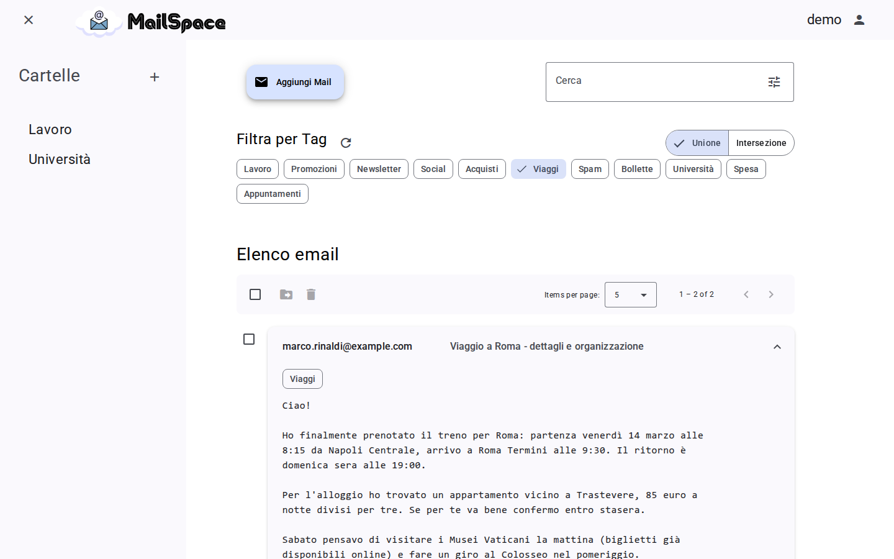
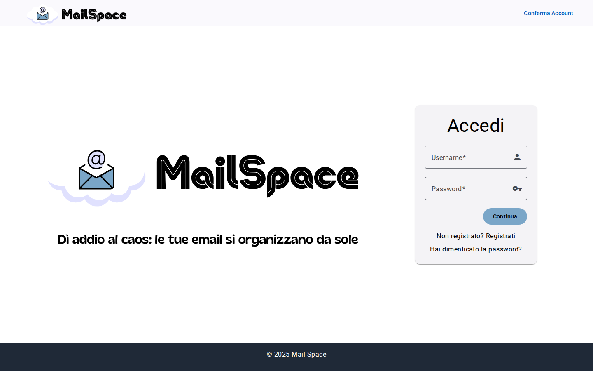
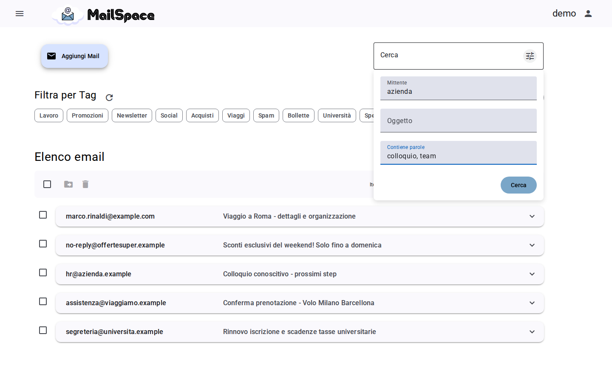
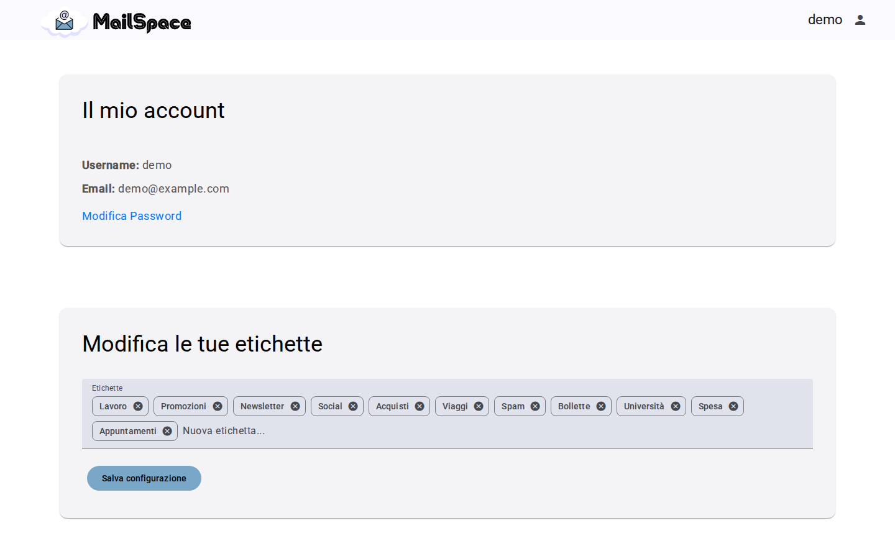

<p align="center">
  
</p>

<p align="center">
  <strong>A cloud web app that organizes your e-mails with AI.</strong><br>
  Upload e-mails, let Google Gemini tag them with <em>your</em> labels, then search, filter and file them in folders.
</p>

<p align="center">
  <a href="https://github.com/GabrieleHML/mail-space/actions/workflows/ci.yml"></a>
  
  
  
  
</p>



Mail Space started as the project for the **Distributed Systems and Cloud Computing** course
(University of Calabria, academic year 2024/25) and was later refactored and hardened as a portfolio project
([what changed](#from-the-exam-version-to-today)). The user interface is in Italian.

## Features

- **Upload e-mails** as `.eml` files or by typing sender, subject and text.
- **AI tagging**: Google Gemini picks the labels that describe each e-mail, choosing only among the labels
  defined by the user.
- **Custom labels**: add, rename or remove labels from the profile page; existing e-mails are re-classified
  automatically.
- **Search**: free text, or by sender, subject and words contained in the body, combined with the tag filters
  (any / all of the selected labels).
- **Folders** to group e-mails by hand.
- **Accounts on Amazon Cognito**: sign-up with e-mail verification, login, password reset and change,
  sessions renewed transparently with refresh tokens.

<table>
  <tr>
    <td></td>
    <td></td>
    <td></td>
  </tr>
  <tr>
    <td align="center">Login</td>
    <td align="center">Advanced search</td>
    <td align="center">Labels used by Gemini, editable by the user</td>
  </tr>
</table>

## Architecture


1. **Users ↔ front-end**: an Angular single-page application running in the browser.
2. **Front-end ↔ NGINX** over HTTPS: NGINX serves the static build and proxies `/api` to the back-end.
3. **NGINX ↔ Node.js**: an Express REST API on the same EC2 instance.
4. **IAM role**: the instance gets its permissions from an instance profile, with no static credentials.
5. **Node.js ↔ services**:
   - Amazon Cognito for identities and tokens.
   - Amazon RDS for PostgreSQL for e-mails, labels and folders.
   - Google Gemini for the classification.

The diagram source is [`docs/architecture.drawio`](docs/architecture.drawio) (editable with draw.io).

### Tech stack

| Area      | Technologies                                                                      |
| --------- | --------------------------------------------------------------------------------- |
| Front-end | Angular 21 (standalone components, signals), Angular Material, Tailwind CSS, RxJS |
| Back-end  | Node.js 22, Express 5, PostgreSQL (`pg`), pino, mailparser, multer                |
| Cloud     | Amazon EC2, Amazon RDS for PostgreSQL, Amazon Cognito, AWS IAM, Google Gemini API |
| Quality   | Jest + Supertest, Vitest, ESLint, Prettier, Docker Compose, GitHub Actions        |

## Design notes

**Authentication.** Cognito issues the tokens; the API verifies the signature of the Cognito ID token against
the user pool public keys (JWKS), together with issuer, audience, token use and expiry
([`aws-jwt-verify`](https://github.com/awslabs/aws-jwt-verify)). The Angular HTTP interceptor adds the token to
every call and, when it expires, refreshes it once and retries the request; on logout the refresh token is
revoked.

**Data isolation.** Every query is scoped to the authenticated user, so guessing the id of another user's
e-mail or folder returns `404`. Integration tests cover these cases.

**Working with an LLM safely.**

- The e-mail is sent as data, separate from the instructions, and the answer is requested as JSON.
- Only labels defined by the user are accepted from the answer.
- Re-classification runs at most 5 requests in parallel, and Gemini calls are rate-limited per user.
- If Gemini is unavailable, the e-mail is still saved, without labels.

**Search.** A single query builder combines all the filters with parameterized SQL. The `%` and `_` characters
typed by the user are matched literally, and PostgreSQL array operators (`&&`, `@>`) back the tag filters with a
GIN index.

**Hardening.**

- Input validation and a request body limit.
- Upload limits: only `.eml` files, up to 10 MB.
- `helmet` security headers.
- Rate limiting on authentication endpoints.
- CORS disabled unless configured.
- TLS with certificate verification towards RDS.
- Errors never expose internal details.

## Getting started

### Prerequisites

- Node.js 22 and Docker (or Podman) with Docker Compose.
- An **Amazon Cognito user pool**:
  - sign-in with username and e-mail;
  - e-mail verification;
  - a password policy of at least 8 characters with upper-case, lower-case, number and symbol.

  Its app client must have **no client secret** and allow the `ALLOW_USER_PASSWORD_AUTH` and
  `ALLOW_REFRESH_TOKEN_AUTH` flows.

- A **Google Gemini API key** from [Google AI Studio](https://aistudio.google.com/apikey).

Create `server/.env` from [`server/.env.example`](server/.env.example) and fill in the Cognito and Gemini
values.

### Run everything with Docker Compose

```bash
cp server/.env.example server/.env   # then fill in Cognito and Gemini
docker compose up --build
```

Open http://localhost:8080. Compose starts:

- PostgreSQL with the [schema](db/schema.sql);
- the API;
- NGINX serving the web app.

Sample e-mails to upload are in [`samples/`](samples/).

### Local development

```bash
docker compose up -d db              # PostgreSQL on localhost:5432 (see the DB_* values in .env.example)

cd server
npm install
npm run dev                          # API on http://localhost:3000, restarts on changes
```

In a second terminal:

```bash
cd client
npm install
npm start                            # http://localhost:4200, /api is proxied to the API
```

### Tests

```bash
docker compose up -d db              # the integration tests use a separate "mailspace_test" database

npm --prefix server install && npm --prefix server test   # unit + integration tests (Jest, Supertest)
npm --prefix client install && npm --prefix client test   # unit tests (Vitest)
```

Cognito and Gemini are mocked in the tests: they need no credentials and cost nothing. The same checks run on
every push in [GitHub Actions](.github/workflows/ci.yml), together with lint, formatting and the Docker builds.

## REST API

All endpoints are under `/api`. Except for the authentication ones, they require
`Authorization: Bearer <Cognito ID token>`.

| Method                | Endpoint                                                                 | Description                                                  |
| --------------------- | ------------------------------------------------------------------------ | ------------------------------------------------------------ |
| `POST`                | `/auth/signup`, `/auth/confirm`                                          | Sign-up and e-mail verification                              |
| `POST`                | `/auth/login`, `/auth/refresh`, `/auth/logout`                           | Tokens: issue, renew, revoke                                 |
| `POST`                | `/auth/forgot-password`, `/auth/reset-password`, `/auth/change-password` | Password management                                          |
| `GET`                 | `/emails?q=&sender=&subject=&words=&labels=&match=all`                   | Search the user's e-mails                                    |
| `POST`                | `/emails`                                                                | Store an e-mail typed in the form                            |
| `POST`                | `/emails/upload`                                                         | Store a `.eml` file (multipart field `file`)                 |
| `DELETE`              | `/emails`                                                                | Delete e-mails (`{ "ids": [...] }`)                          |
| `GET` `POST`          | `/folders`                                                               | List / create folders                                        |
| `DELETE`              | `/folders/:id`                                                           | Delete a folder                                              |
| `GET` `POST` `DELETE` | `/folders/:id/emails`                                                    | List / add / remove the e-mails of a folder                  |
| `GET` `PUT`           | `/labels`                                                                | Read / replace the user's labels (re-classifies the e-mails) |
| `GET`                 | `/health`                                                                | Health check                                                 |

Errors are returned as `{ "message": "...", "code": "..." }`, where `code` (e.g. `UsernameExistsException`)
lets the client show a specific message.

## Deployment

The course version ran on AWS:

- **EC2**: one Ubuntu instance running NGINX and the Node.js API. Its IAM role grants access to the other
  services.
- **RDS**: PostgreSQL on a `db.t4g.micro` instance.
- **Cognito**: a user pool for the accounts.
- **Domain and HTTPS**: a custom domain pointing to the instance's Elastic IP, with a Let's Encrypt
  certificate issued by Certbot.

The NGINX configuration is in [`deploy/nginx.conf`](deploy/nginx.conf). To connect to RDS with certificate
verification, set `DB_CA_PATH` to the [RDS CA bundle](https://truststore.pki.rds.amazonaws.com/global/global-bundle.pem).

## Project structure

```
client/        Angular app (components, services, HTTP interceptor, route guard)
server/
  src/         Express API: routes → controllers → services → repositories
  test/        unit and integration tests
db/            PostgreSQL schema
deploy/        NGINX configuration for an EC2 deployment
docs/          architecture diagram, screenshots, course report (Italian)
samples/       sample .eml files with fictitious data
```

## From the exam version to today

The version delivered for the exam is described in the course report,
[`docs/relazione.pdf`](docs/relazione.pdf) (Italian), whose API and code layout differ from the current ones.
It went through two changes of direction:

- **Amazon Comprehend → Google Gemini**: the first version extracted key phrases with Comprehend and stored
  e-mails on S3. Gemini replaced it, so that each e-mail gets the user's own labels instead of generic key
  phrases.
- **Refactoring after the exam**:
  - **Security**: fixed missing ownership checks that allowed access to other users' data.
  - **Authentication**: moved to Cognito tokens verified with JWKS, with refresh and revocation.
  - **API**: redesigned the REST API.
  - **Upgrades**: Angular 18 → 21, AWS SDK v2 → v3, and the new Gemini SDK (the model used originally has since
    been retired).
  - **Quality**: added automated tests, Docker Compose, CI, linting and formatting.

## Limitations and future work

- **Classification**: re-classifying many e-mails happens inside the HTTP request; a queue (e.g. Amazon SQS
  with a worker) would scale better.
- **Search and pagination**: search uses `ILIKE`, which is fine for a personal inbox. Larger volumes would call
  for PostgreSQL full-text search and server-side pagination.
- **Data model**: e-mails are linked to the user's e-mail address; the immutable Cognito `sub` would be a more
  robust key.
- **Sessions**: tokens are kept in `localStorage`. An HTTP-only cookie session (backend-for-frontend) would
  reduce the impact of an XSS bug.
- **Ideas from the report**:
  - removing personal data before sending text to Gemini;
  - two-factor authentication;
  - sentiment and entity extraction;
  - importing mail directly from Gmail or Outlook.

## License

[MIT](LICENSE) © Gabriele Hamil
